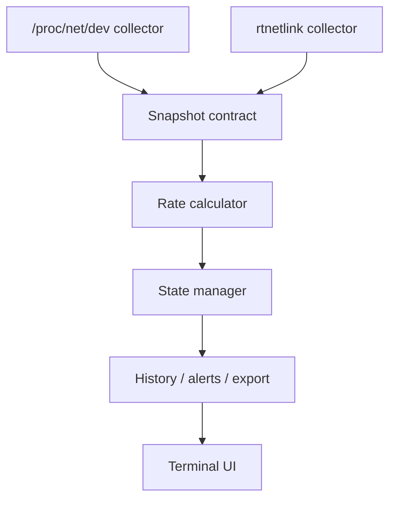

# Future Features & Improvements

A prioritised roadmap for `net-monitor-rs`, extracted from the design discussion in
`chat-export-1794346956411.json` and reconciled against the code that actually
exists today.

The export contained three overlapping lists (a brainstorm of ~18 feature
categories, a structured options-and-recommendations doc, and a consolidated
six-phase roadmap). This file merges them into one, drops what is already
implemented, and flags where the export's advice does not match this codebase.

**Guiding rule from the source material:** keep the collector, calculator, state
and UI layers separate, so the dashboard never learns *how* its data was
obtained. Every phase below assumes that rule holds.

---

## Current status

Verified against `src/collector.rs`, `src/calculator.rs`, `src/ui.rs`,
`src/main.rs`.

| Capability | Export's phase | State here |
| --- | --- | --- |
| Read `/proc/net/dev` | 1 | **Done** — `read_network_stats()` |
| Delta rates over real elapsed time | 1 | **Done** — `Instant`, not the nominal 1 s |
| Counter-reset safety | 1 | **Done** — `saturating_sub` |
| Baseline before first rate | 1 | **Done** — no rates until a 2nd sample |
| Ratatui table dashboard | 2 | **Done** |
| Human-readable units | 2 | **Done** — binary `KiB`/`MiB`/`GiB` labels |
| Colour-coded RX/TX | 2 | Partial — static green/blue, no thresholds |
| Errors / drops | 2 | Partial — cumulative, summed into one column |
| Stable row order | 2 | **Done** — sorted by name |
| Resize handling | 2 | **Done** — `ui::draw` re-reads `f.area()` each frame |
| Keyboard quit | 2 | **Done** — `q` / `Esc` |
| Two-thread collect/render split | 2 | **Done** |
| Interface filtering / hiding | 2 | Missing |
| Sorting options | 2 | Missing |
| Bit-based units (Mbps) | 2 | Missing |
| Link state / MTU / MAC / speed | 2 | Missing |
| Error & drop *rates* | 2 | Missing |
| Warning badges | 2 | Missing |
| Help overlay (`?`) | 2 | Missing |
| Packets-per-second | 2 | **Done** — delta-computed and shown as `Pkt RX/TX` |
| Rolling history / sparklines / chart | 3 | Missing |
| Peak & session totals | 3 | Missing |
| Multi-window rates (1s/10s/1m/5m) | 3 | Missing |
| CSV / JSON / JSONL export | 3, 6 | Missing |
| Config file / CLI flags | 10 | Missing |
| Tests | 9 | **None** |
| Netlink collector | 4 | Missing |
| Socket / connection table | 5 | Missing |
| Process attribution | 5 | Missing |
| Packet inspection | 6 | Missing |

Phase 1 is complete, most of Phase 2's *plumbing* is there, and the Tier 0
hygiene items below have landed. What is missing is the diagnostic metadata,
the interaction layer, and all of Phase 3 onward.

---

## Tier 0 — Correctness and hygiene (DONE)

Items surfaced by reading this repo rather than by the export. All seven are
resolved; recorded here so the reasoning and the verification stay available.

1. **Terminal restore on abnormal exit.** `main.rs` previously ran
   `disable_raw_mode` + `LeaveAlternateScreen` only on the clean `q`/`Esc` path,
   so an `Err` from `event::poll()?`/`event::read()?` or a panic in the draw loop
   left the shell in raw mode. Fixed with a `TerminalGuard` RAII type plus a
   `panic::set_hook` wrapper that restores the screen *before* delegating to the
   default hook — otherwise the panic text is printed onto the alternate screen
   and vanishes with it. Restore is idempotent, so guard and hook can both fire
   safely.
   *Verified:* forcing a panic exits 101 with `+icanon +onlcr +echo +isig`
   restored, `\x1b[?1049l` emitted before the message, mouse capture released,
   cursor reshown. Clean quit verified the same way.
2. **Clippy lints.** The two `collapsible_if` warnings at `main.rs:67-69` are
   collapsed into a single `if poll()? && let Event::Key(key) = read()? &&
   (…)` chain. `cargo clippy` is now warning-free.
3. **Unused packet counters.** Resolved by surfacing them rather than deleting
   them (see item 4), so the `#[allow(dead_code)]` annotations are gone.
4. **Packets per second.** `InterfaceRate` now carries `rx_pps`/`tx_pps` as
   rates rather than raw totals, computed from packet deltas in
   `StateManager::update` alongside the byte deltas. Rendered in a `Pkt RX/TX`
   column; the six percentage constraints were rebalanced to seven.
   *Verified against a known quantity:* `ping -i 0.2` on loopback produced
   `10/10` pps and `839.79 B/s`, matching 10 packets/s × 84 bytes.
5. **Unit labelling.** `format_rate()`/`format_bytes()` now emit
   `KiB`/`MiB`/`GiB` to match the 1024 divisor. The bit-based toggle
   (`Mbps`) remains a Tier 1 item.
6. **License.** `LICENSE` added (MIT, © 2026 Avinash) and declared via
   `license = "MIT"` in `Cargo.toml`, alongside a `description` field.
7. **First commit.** Still outstanding — the repo is on an unborn `master` with
   no remote. Not done automatically; see the note at the bottom.

`cargo fmt --check`, `cargo build` and `cargo clippy` are all clean.

---

## Tier 1 — Phase 2: UI polish and health metrics

High value, low risk, no new data sources beyond optional sysfs reads.

| Feature | Difficulty | Notes for this codebase |
| --- | --- | --- |
| Interface filtering (hide `lo`, `docker0`, `veth*`, `br-*`, `virbr0`, `tun0`, `wg0`) | Easy | Filter in `ui::draw` or in `StateManager::update`; keep the raw set intact so a toggle is instant |
| Interactive selection / focus | Easy | `j`/`k` move, `Enter` focus, `Tab` all-vs-one; needs a cursor field in UI state |
| Sorting options | Easy | Generalise the existing `sort_by(|a,b| a.name.cmp(&b.name))` — by RX rate, TX rate, total, errors, drops, combined |
| Bit-based units | Easy | `Mbps = bytes_per_sec * 8 / 1_000_000`; add a `u` key cycling bytes/bits/binary |
| Threshold colours | Easy | Replace the static `Color::Green`/`Blue` with a lookup on configurable warn/critical thresholds |
| Link state | Easy | `/sys/class/net/<iface>/operstate` → `up`/`down`/`unknown`/`dormant`/`lowerlayerdown` |
| MTU, MAC, speed, duplex | Easy | sysfs: `mtu`, `address`, `speed`, `duplex`. Virtual interfaces report speed `-1` or fail — model as `Option` |
| Error / drop **rates** | Easy | Deltas are already computed for bytes; mirror the logic for `rx_errors`/`tx_errors`/`rx_dropped`/`tx_dropped` |
| Warning badges | Easy | `⚠ drops increasing` when a drop delta > 0 in the last sample; `⚠ interface down`; `⚠ high utilisation` |
| Help overlay | Easy | `?` / `h` toggles a key-binding popup; the header currently hardcodes "(Press 'q' to quit)" |
| Session totals | Easy | Distinct from the since-boot counters already shown: accumulate deltas since startup |
| Capability-aware startup | Easy | Print which features are disabled and why (no `CAP_NET_RAW`, no root) |

Sysfs helper the export sketched, adapted to here:

```rust
fn read_sysfs_u32(path: &str) -> Option<u32> {
    std::fs::read_to_string(path).ok()?.trim().parse().ok()
}

fn link_state(iface: &str) -> Option<String> {
    std::fs::read_to_string(format!("/sys/class/net/{iface}/operstate"))
        .ok()
        .map(|s| s.trim().to_string())
}
```

Target layout after this tier:

```text
┌──────────────────────────────────────────────────────────────────┐
│ Rust Net Monitor                     [?] Help   [q] Quit         │
├──────────────────────────────────────────────────────────────────┤
│ Interface  State  RX Rate    TX Rate     Errors/s  Drops/s       │
│ eth0       UP     12.4 Mbps  3.1 Mbps    0          0.4 ⚠        │
│ wlan0      DOWN   0.0 Mbps   0.0 Mbps    0          0            │
│ lo         UP     0.1 Mbps   0.1 Mbps    0          0            │
└──────────────────────────────────────────────────────────────────┘
```

Recommended key map from the export:

```text
q / Esc   Quit          f   Filter interfaces
? / h     Help          s   Sort options
Tab       Switch view   u   Toggle units
j / Down  Move down     r   Reset history
k / Up    Move up       Enter  Focus interface
```

**Design note:** `InterfaceSnapshot::name` was removed in this repo because the
`HashMap` is already keyed by name. The export's struct definitions still show
that field; if you adopt them verbatim you will reintroduce the redundancy. Keep
name lookup keyed by the map, and carry `name` only on the output `InterfaceRate`
(where the UI and the sort both read it).

---

## Tier 2 — Phase 3: History and visualisation

Turns the tool from a counter viewer into a diagnostic one.

| Feature | Difficulty | Notes |
| --- | --- | --- |
| Rolling history buffer | Easy | **Must be bounded.** `VecDeque<Sample>` with `max_len`; default 60 samples at 1 Hz |
| Sparklines per row | Easy | ratatui has a `Sparkline` widget; RX and TX rows of `▁▂▃▅▇█` |
| Full chart for focused interface | Medium | ratatui `Chart`; pairs with the selection feature in Tier 1 |
| Peak tracking | Easy | Max RX/TX during session, ideally with a timestamp |
| Session summary on exit | Easy | Duration, totals, peaks, interfaces seen, warning count |
| Multi-window rates | Medium | 1s / 10s / 1m / 5m averages, separates bursts from sustained transfers |
| Percentiles | Medium | average, median, p95, max burst |
| Configurable retention | Easy | 60 s default; optional 5 m and 30 m |

The export's buffer, which is directly usable:

```rust
use std::collections::VecDeque;

pub struct Sample {
    pub timestamp: std::time::SystemTime,
    pub interface: String,
    pub rx_rate_bps: f64,
    pub tx_rate_bps: f64,
    pub rx_errors: u64,
    pub tx_errors: u64,
    pub rx_dropped: u64,
    pub tx_dropped: u64,
}

pub struct HistoryBuffer {
    samples: VecDeque<Sample>,
    max_len: usize,
}

impl HistoryBuffer {
    pub fn new(max_len: usize) -> Self {
        Self { samples: VecDeque::with_capacity(max_len), max_len }
    }

    pub fn push(&mut self, sample: Sample) {
        if self.samples.len() >= self.max_len {
            self.samples.pop_front();
        }
        self.samples.push_back(sample);
    }
}
```

**Where it belongs:** a new `src/history.rs`, fed by the collector thread — *not*
the UI thread. `StateManager` already owns the previous-sample comparison, so
appending each finished `InterfaceRate` to a per-interface buffer inside
`update()` keeps the UI read-only.

**Interaction with the current channel:** `main.rs` clones `state.current_rates`
into an `mpsc` channel and the UI drains stale frames with `try_recv`. History
must live behind the channel (collector-side) or the UI will lose samples it
never got around to rendering. This is the one place the existing design would
break a naive implementation.

---

## Tier 3 — Phase 4: Netlink integration

Replace fragile text parsing with structured kernel messaging.

| Feature | Priority | Difficulty |
| --- | --- | --- |
| Track interfaces by `ifindex`, not name | High | Medium |
| Enumerate links via Netlink | Medium | Medium |
| Subscribe to `RTM_NEWLINK` / `RTM_DELLINK` events | Medium | Hard |
| React to link up/down without polling | Medium | Medium |
| Read IPv4/IPv6 addresses per interface | Medium | Medium |
| Read routes / default route | Low | Medium |
| Network-namespace awareness | Low | Hard |

Why bother: names get reused and renamed; indexes do not. Event subscription also
removes the "interface vanished between samples" class of bug that polling
invites, which matters on hosts with Docker, KVM, VPN or Wi-Fi churn.

Crates: `rtnetlink` (mature, widely used), `nlink` (newer, ergonomic), plus
`netlink-sys` / `netlink-proto`, and `tokio` for the async I/O.

```toml
[dependencies]
rtnetlink = "..."
nlink = "..."
tokio = { version = "...", features = ["full"] }
```

**Migration path that preserves the layering:** introduce a collector trait so
`/proc/net/dev` and Netlink are interchangeable behind it. `InterfaceSnapshot`
stays the contract; `StateManager`, `history` and `ui` do not change at all.
That is precisely the payoff the export's "separate collection from
presentation" rule is buying you.



Note this is the first tier that realistically adds an async runtime, which cuts
against the current "no async, 320 lines" character. Worth treating as an
optional feature flag (`--features netlink`) rather than a hard replacement.

---

## Tier 4 — Phase 5: Sockets and process attribution

Answers "who is using the network?" — with a hard honesty constraint.

> **Critical caveat, repeated throughout the export:** socket ownership is not
> bandwidth usage. Mapping a socket to a PID tells you *who holds the
> connection*, not how many bytes they moved recently. True per-process
> bandwidth needs eBPF or packet-capture correlation. Any table you build here
> must label its method and confidence.

| Feature | Priority | Difficulty |
| --- | --- | --- |
| TCP/UDP connection table | Medium | Medium |
| Listening-ports view (security auditing) | Medium | Easy |
| Connection-state summary (`ESTABLISHED`, `TIME_WAIT`, `CLOSE_WAIT`, …) | Medium | Easy |
| Filter by port / IP / state | Medium | Medium |
| Socket-to-PID map via `/proc/*/fd` inode symlinks | Low | Hard |
| Process names resolved from PID | Low | Easy |
| Per-process connection counts | Low | Medium |
| eBPF per-process byte counts | Low | Very hard |

Sources: `/proc/net/tcp`, `/proc/net/tcp6`, `/proc/net/udp`, `/proc/net/udp6`;
`NETLINK_SOCK_DIAG` for the structured route; `/proc/<pid>/fd/<socket_inode>`
for attribution. eBPF via `aya` or `libbpf-rs`, attaching to `tcp_sendmsg`,
`tcp_recvmsg`, `udp_sendmsg`, `udp_recvmsg`.

High `TIME_WAIT` or `CLOSE_WAIT` counts are a genuine diagnostic signal —
application or kernel tuning problems — which is why the state summary earns its
place despite being cheap.

UI shape: a tab bar `[Interfaces] [Connections] [Processes] [Packets]`, with the
connection table living in the same channel as everything else.

---

## Tier 5 — Phase 6: Inspection, export, alerting

Deepest layer; highest permission and privacy burden.

**Export / integration** (mostly easy, do these first within the tier):

- JSON or CSV snapshot: `--export json --output snapshot.json`
- JSONL streaming for Vector / Fluent Bit / Loki / `jq`
- Prometheus endpoint: `net_interface_rx_bytes_total{interface="eth0"}`,
  `net_interface_rx_bytes_per_second{...}` via the `prometheus` crate plus
  `axum`/`poem`/`warp`
- systemd unit for headless servers
- Non-TUI `snapshot --json` subcommand for scripting
- `--self-test` that verifies procfs readability, sysfs readability, Netlink
  socket creation, raw-mode support, and the rate/reset math

**Alerting:** threshold config, on-screen `ALERT:` lines, desktop notifications
(`notify-rust`, DBus, terminal bell), webhook POSTs for home labs.

**Packet inspection** (needs root or `CAP_NET_RAW`): top talkers by IP, protocol
breakdown, flow/conversation table, DNS query monitoring, TLS SNI extraction.
Crates: `pcap`, `pnet`/`libpnet`, `af_packet`, eBPF/XDP.

**Privacy requirements the export insists on** — treat these as non-optional if
you implement any of the above:

- explicit opt-in flags
- mask payloads by default; headers only unless enabled
- `--redact` to hide remote IPs, domains, process names, local paths
- restricted file permissions, rotation and max size on any capture files
- warn about sensitive-data exposure

**Linux-specific extras:** container interface mapping (`veth*` → container ID,
`docker0`, `cni0`, `flannel.1`), VPN awareness (`wg0`, `tun0`, `tap0`), Wi-Fi
details via `nl80211`/`iw`/NetworkManager D-Bus (SSID, BSSID, signal, bitrate),
and `tc`/QoS queue stats explaining why an interface underperforms its link
speed.

---

## Testing and validation

The export's framing is the right one: *a monitor is useless if its numbers are
wrong.* There are currently zero tests in this repo.

**Unit tests** — highest value first, and all of them are pure-function tests
against fixtures, no root required:

- `read_network_stats()` against a captured `/proc/net/dev` fixture file
- parser edge cases: missing fields, extra whitespace, empty lines, unusual
  interface names, very large counters, rows with < 16 fields (must be skipped,
  not panic)
- `saturating_sub` reset behaviour with synthetic counter pairs
- elapsed-time arithmetic
- interface disappearing between samples
- `format_rate()` / `format_bytes()` boundaries (1023 vs 1024, GB rollover)
- `HistoryBuffer` overflow and eviction, once Tier 2 lands

The parser currently takes a hardcoded path. Inject the content (or the path) so
fixtures work without touching the real procfs.

**Cross-validation against standard tools:**

```bash
cat /proc/net/dev
ip -s link show eth0     # compare against the app's "Total RX"
curl -o /dev/null https://speed.cloudflare.com/__down?bytes=10000000  # watch RX spike
```

A `--compare` mode printing your value beside `ip -s link` with the diff is the
export's "compare mode" idea; it builds trust cheaply.

**Integration / edge cases:**

- create a `dummy` interface, generate traffic with `iperf3`, verify non-zero
  rates, remove the interface and confirm the UI recovers
- interface disconnect/reconnect
- virtual interface churn under Docker/KVM
- suspend/resume cycles
- rapid terminal resizing (already handled incidentally, but untested)

---

## Configuration target

Nothing here exists yet; `main.rs` has no CLI parsing at all.

`~/.config/net-monitor-rs/config.toml`:

```toml
refresh_interval_ms = 1000
history_seconds = 60
default_unit = "bits"   # or "bytes" | "binary"

[interfaces]
hide = ["lo", "docker0", "veth*"]
highlight = ["eth0", "wlan0"]

[thresholds]
rx_warn_mbps = 50
rx_crit_mbps = 200
drop_warn_per_sec = 1
error_warn_per_sec = 1

[ui]
theme = "dark"          # dark | light | monochrome
mouse = true
colorblind_safe = false
```

CLI, via `clap` (or `argh` if you want to stay light):

```bash
net-monitor-rs --interval 500ms --interface eth0 --unit mbps --no-color
net-monitor-rs --export json --output snapshot.json
net-monitor-rs --stream jsonl
net-monitor-rs --self-test
net-monitor-rs --redact
```

Config parsing implies `serde` + `toml`; export implies `serde_json`. Both are
reasonable additions, but they do grow the dependency tree from today's three
crates.

---

## Crate palette

| Crate | Tier | Purpose |
| --- | --- | --- |
| `ratatui`, `crossterm`, `anyhow` | — | Already in use |
| `clap` or `argh` | 1 | CLI flags |
| `serde`, `serde_json`, `toml` | 1, 3 | Config and export |
| `tracing`, `tracing-subscriber` | 1 | Structured warning logs to file |
| `rtnetlink` / `nlink`, `tokio` | 3 | Netlink, async I/O |
| `prometheus`, `axum` | 4 | Metrics endpoint |
| `notify-rust` | 4 | Desktop notifications |
| `pcap` / `pnet` | 5 | Packet capture |
| `aya` / `libbpf-rs` | 4, 5 | eBPF attribution |

---

## Suggested release plan

Condensed from the export's checklist, minus what is already done here.

**v0.2 — dependable interface monitor (Tier 0 + Tier 1)**
- [x] Terminal-restore guard, clippy clean, license
- [x] Packets-per-second column
- [ ] First commit (repo still on unborn `master`)
- [ ] Link state, MTU, MAC, speed from sysfs
- [ ] Error/drop rates and warning badges
- [ ] Interface filtering and sorting
- [ ] Bit/byte/binary unit toggle
- [ ] Session totals
- [ ] Help overlay
- [ ] Config file + CLI flags
- [ ] First unit tests for the parser and rate maths

**v0.3 — diagnostic dashboard (Tier 2 + export)**
- [ ] Bounded rolling history (60 s)
- [ ] Sparklines and full chart
- [ ] Peak tracking, multi-window rates
- [ ] Session summary on exit
- [ ] JSON/CSV export, `--self-test`
- [ ] Integration tests with `dummy`/`iperf3`

**v1.0 — Linux-native core (Tier 3 + Tier 4)**
- [ ] Collector trait; Netlink implementation behind a feature flag
- [ ] `ifindex` tracking, link add/remove events
- [ ] IP addresses per interface
- [ ] TCP/UDP connection table, listening ports, state summary
- [ ] Prometheus endpoint

**v1.x — attribution and depth (Tier 4 + Tier 5)**
- [ ] Socket-to-PID mapping, clearly labelled best-effort
- [ ] Optional packet capture, top talkers, protocol breakdown
- [ ] eBPF per-process bytes
- [ ] Namespace/container/Wi-Fi/QoS awareness
- [ ] Full privacy controls

---

## References

- Source article: *I Built a Linux Network Monitor in Rust. Here's How It Works*
  (Yorn Rothy, Medium, Nov 2026) — attached to the original chat as a PDF
- Linux kernel docs: [Interface Statistics](https://www.kernel.org/doc/html/latest/networking/statistics.html)
- Original discussion: `chat-export-1794346956411.json` (4 turns: build request,
  feature brainstorm, options-and-recommendations doc, consolidated roadmap).
  Deleted from the repo after extraction; this file is the surviving record.
