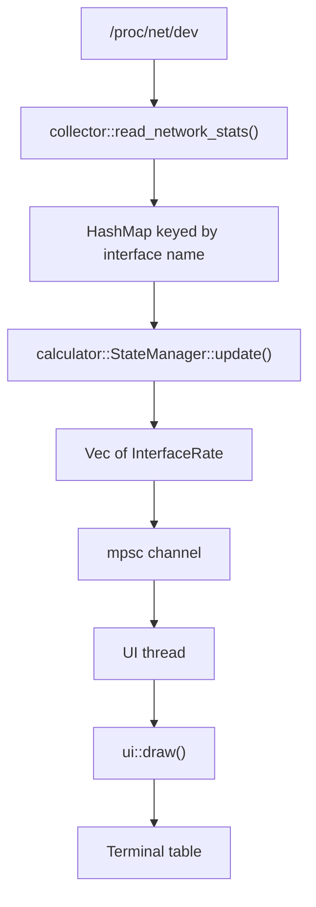

# net-monitor-rs

A lightweight terminal dashboard that monitors Linux network interfaces in real
time. It reads kernel counters from `/proc/net/dev` once a second, converts the
cumulative byte counters into live per-second rates, and renders them in a
[`ratatui`](https://ratatui.rs) table.

It is a small, dependency-light alternative to `iftop`/`nload` for anyone who
wants a readable TUI and a codebase simple enough to hack on. About 350 lines
of Rust across four modules, no async runtime, and no root privileges required.

## Features

- **Live RX/TX rates** per interface, sampled every second
- **Packets-per-second** counters alongside byte throughput
- **Cumulative totals** alongside instantaneous rates
- **Binary unit labels** — `KiB`/`MiB`/`GiB`, matching the 1024 divisor
- **Error and drop counters** folded into a single `Errors / Drops` column
- **Counter-reset safe** — uses saturating subtraction, so an interface reset or
  counter wrap never produces a negative rate
- **Two-thread design** — collection and rendering are decoupled, so a slow
  read never stalls the UI
- **Panic-safe teardown** — raw mode and the alternate screen are restored on
  every exit path, including panics
- **Zero config** — no CLI flags, config file, or network access

## Example

```text
┌─ Dashboard ────────────────────────────────────────────────────────────────┐
│ Rust Linux Network Monitor (Press 'q' to quit)                             │
└────────────────────────────────────────────────────────────────────────────┘

┌─ Network Interfaces ───────────────────────────────────────────────────────┐
│ Interface RX Rate     TX Rate     Total RX  Total TX  Pkt RX/TX Err/Drp    │
│                                                                            │
│ eth0      12.4 MiB/s  3.1 MiB/s   76.28 MiB 331.6 KiB 10/10     0/0        │
│ wlan0     839.79 B/s  839.79 B/s  14.81 KiB 14.81 KiB 10/10     0/0        │
│ lo        0.00 B/s    0.00 B/s    13.99 KiB 13.99 KiB 0/0       0/0        │
└────────────────────────────────────────────────────────────────────────────┘
```

*(Values above are illustrative; the real table reflects your interfaces.)*

## Requirements

| Requirement | Detail |
| --- | --- |
| **OS** | Linux only — the parser depends on `/proc/net/dev` |
| **Rust** | 1.85+ (the crate uses edition 2024) |
| **Privileges** | None; a normal user account can read the stats |
| **Terminal** | Any terminal supporting alternate screen + ANSI colour |

## Usage

```bash
git clone <your-repo-url>
cd net-monitor-rs
cargo run --release
```

Then press `q` or `Esc` to quit.

> **Note:** the terminal is switched into raw mode and an alternate screen for
> the duration of the run. A RAII guard plus a custom panic hook restore it on
> every exit path — clean quit, an `Err` propagated by `?`, or a panic — so your
> shell is never left in raw mode. The panic hook exits the alternate screen
> *before* printing, so the message stays visible.

## How it works

Data flows in one direction: the kernel's counter file is parsed into a
snapshot, snapshots are diffed against the previous sample to produce rates,
and rates are handed to the UI thread.



### Sampling and rate maths

`/proc/net/dev` exposes **monotonic cumulative counters**, not rates, so the
rate is derived:

```text
rx_rate = (current.rx_bytes - previous.rx_bytes) / elapsed_seconds
```

`elapsed` is measured with `std::time::Instant`, not the nominal 1 s sleep, so
scheduling jitter does not skew the result. The first sample only establishes a
baseline — no rates are emitted until a second sample arrives. Interfaces are
sorted by name before being published, so rows do not reorder themselves on
every tick (the underlying collection is a `HashMap`, which iterates in
unspecified order).

### Counter layout

The parser skips the two header lines, splits each row on `:`, and reads the 16
whitespace-separated numeric fields. Receive occupies fields `0-7`, transmit
occupies `8-15`:

| Field | RX index | TX index | Used |
| --- | --- | --- | --- |
| bytes | 0 | 8 | yes |
| packets | 1 | 9 | yes |
| errors | 2 | 10 | yes |
| dropped | 3 | 11 | yes |
| fifo / frame / colls / carrier / compressed | 4–7 | 12–15 | no |

Rows with fewer than 16 numeric fields are ignored rather than treated as an
error, which keeps the parser resilient to unexpected `procfs` formatting.

### Concurrency model

`main.rs` runs two threads:

- **Collector thread** — sleeps 1 s, reads stats, updates `StateManager`, and
  sends a cloned `Vec<InterfaceRate>` over an `mpsc` channel.
- **Main/UI thread** — drains the channel with `try_recv()` in a loop so it
  always renders the newest sample rather than replaying a backlog, then draws
  and polls for input on a 100 ms timeout.

The channel is deliberately unbounded and drained before each draw: at one
message per second a backlog is impossible, and dropping stale frames keeps the
UI responsive.

## Project layout

```text
src/
├── main.rs        terminal setup, thread orchestration, event loop, teardown
├── collector.rs   /proc/net/dev parsing -> InterfaceSnapshot
├── calculator.rs  rate computation + StateManager -> InterfaceRate
└── ui.rs          ratatui table rendering and byte/rate formatting
```

| Module | Key items | Responsibility |
| --- | --- | --- |
| `collector` | `InterfaceSnapshot`, `read_network_stats()` | Turn `procfs` text into typed counters |
| `calculator` | `StateManager`, `InterfaceRate` | Diff consecutive snapshots into rates |
| `ui` | `draw()`, `format_rate()`, `format_bytes()` | Render the dashboard |
| `main` | `main()` | Own the terminal, bridge the two threads |

## Dependencies

| Crate | Version | Why |
| --- | --- | --- |
| `ratatui` | 0.30 | Immediate-mode TUI framework and widgets |
| `crossterm` | 0.29 | Raw mode, alternate screen, keyboard events |
| `anyhow` | 1.0 | Ergonomic error propagation in `main` |

No async runtime, no proc-macro-heavy stack, and nothing is fetched at
runtime — the only I/O is a local file read.

## Design notes and limitations

- **Linux-only by construction.** Counters come from `procfs`, so there is no
  macOS/BSD/Windows path. A portable build would need something like the
  `sysinfo` crate behind `#[cfg]` targets.
- **Interface-level, not connection-level.** `net-monitor-rs` reports aggregate
  throughput per interface. It cannot tell you *which* process or peer is using
  the bandwidth, since that would require netlink or packet capture.
- **All interfaces are shown**, including `lo` and virtual bridges. A filter or
  toggle would be a natural addition.
- **Units are binary.** `format_rate()` and `format_bytes()` divide by 1024 and
  label the result `KiB`/`MiB`/`GiB`. Bit-based rates (`Mbps`) are not offered
  yet; see [`FUTURE_FEATURES.md`](FUTURE_FEATURES.md).
- **Rates are averages over the sample window.** A burst shorter than the 1 s
  interval is smoothed into the average rather than shown as a spike.

## Possible extensions

- Per-interface sparkline / rolling history graph
- Filter or hide loopback and virtual interfaces
- Configurable sample interval via a CLI flag
- Alerting thresholds (e.g. highlight an interface saturating its link speed)
- Unit tests for `read_network_stats()` using a fixture `procfs` file

## License

Released under the [MIT License](LICENSE).
